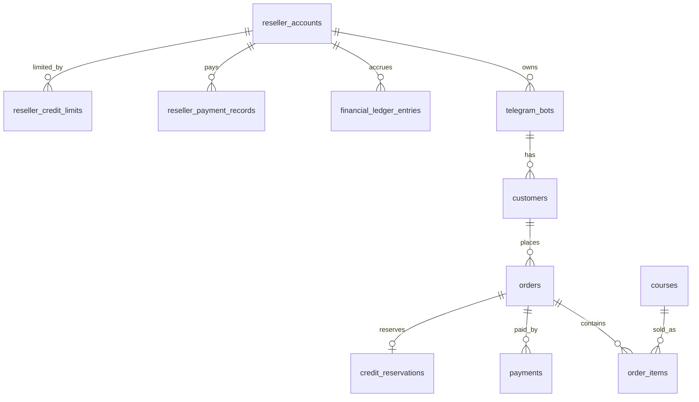

# Accounting event (fixed rule)
Owner's 50% receivable is created ONLY when payment is verified AND the credit
reservation is converted to consumed, in one DB transaction (ledger entry `sale_accrual`,
idempotency key `sale:<order_id>`).

| Situation | Ledger effect |
|---|---|
| Order created / payment pending | none |
| Credit reserved at checkout | none (reservation row only) |
| Payment failed / cancelled | release reservation, none |
| Paid but credit exhausted | state paid_pending_fulfillment, no accrual until Super Admin resolves |
| Duplicate webhook / update | blocked by unique idempotency key |
| Refund | new reversing entry `refund_reversal` (negative deltas); old rows untouched |
| Reseller pays owner | `reseller_payment` entry, owner_share_delta negative |

outstanding = sum(owner_share_delta); available = max(0, limit - outstanding - held reservations)

